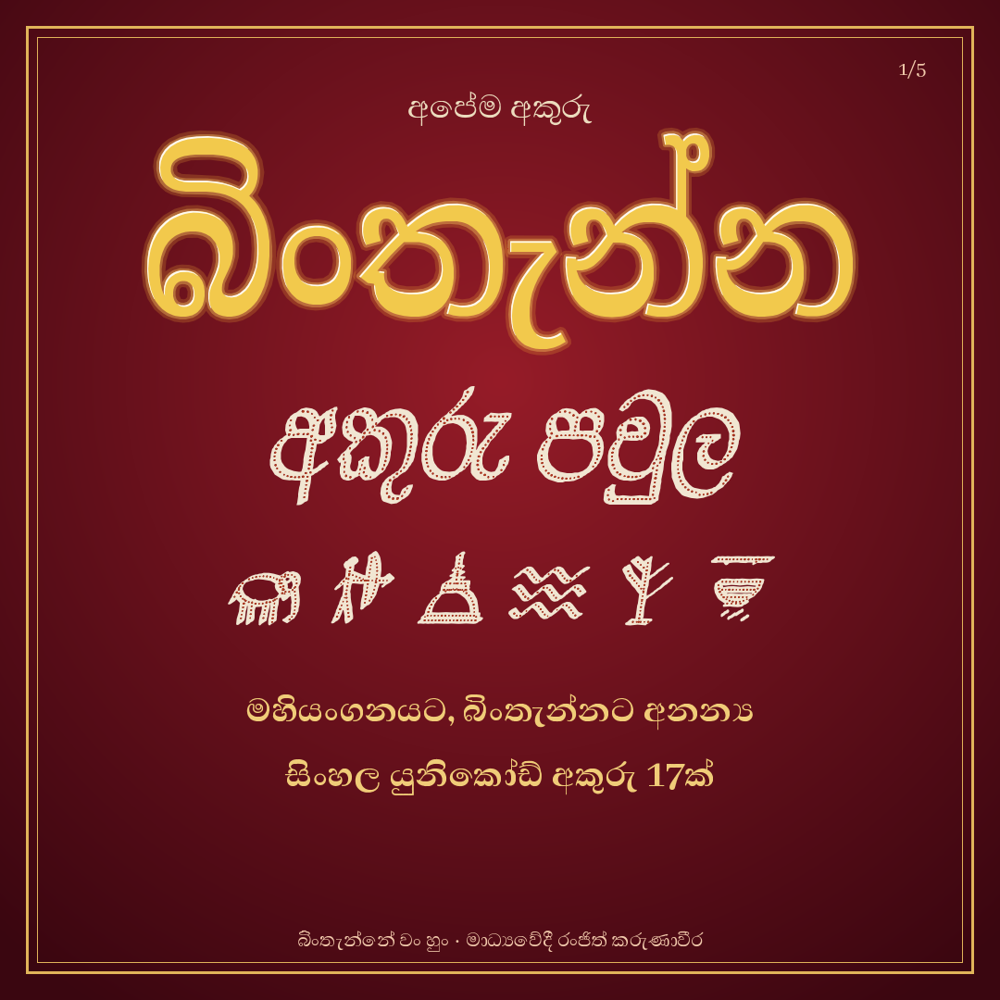
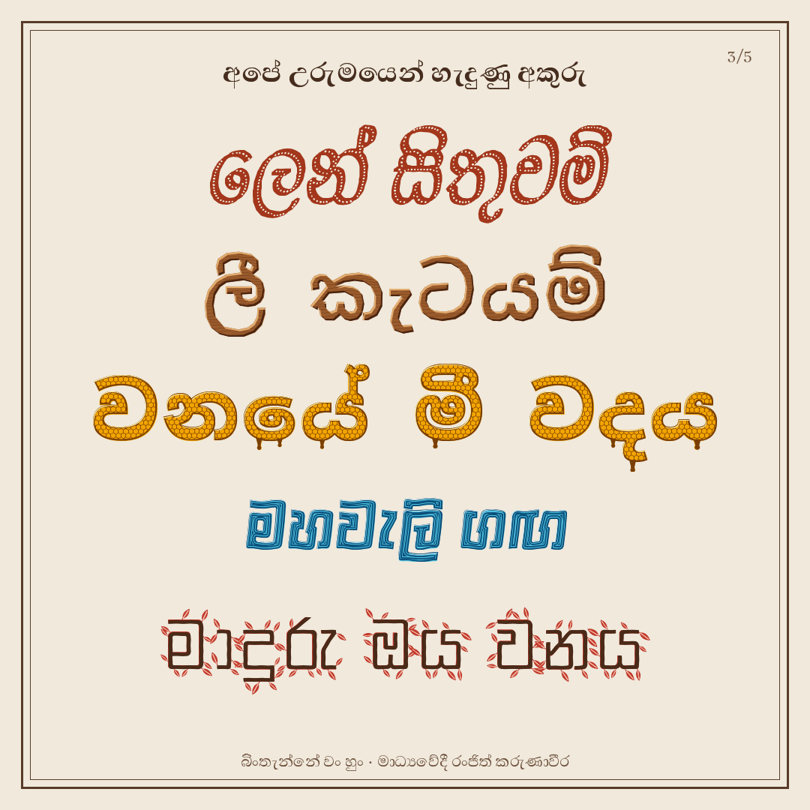

# බිංතැන්න අකුරු පවුල · Bintenna Font Family

**මහියංගනයට, බිංතැන්නට අනන්‍ය සිංහල යුනිකෝඩ් අකුරු 17ක්**
*17 Sinhala Unicode fonts inspired by the heritage of Bintenna and Mahiyangana, Sri Lanka*

නිර්මාණය: **මාධ්‍යවේදී රංජිත් කරුණාවීර** · Created by media personality **Ranjith Karunaweera**

## ⬇️ Download

සියලු අකුරු එකවර: **[Releases](https://github.com/ranji421-cloud/bintenna-fonts/releases/latest)** → `Bintenna-Family-v1.0.zip`

හෝ පහත folder එකකට ගොස් `.ttf` ගොනුව download කරන්න.

## අකුරු ලැයිස්තුව · The fonts

| # | අකුර | ගතිය | හොඳම භාවිතය |
|---|---|---|---|
| 01 | [බිංතැන්න](01-Bintenna) | ලෙන් බිත්තියේ අළුවෙන් ඇඳි ගතිය | මාතෘකා (අඳුරු පසුබිම) |
| 02 | [බිංතැන්න ගල්](02-BintennaGal) | ගල් කැටයම් | මාතෘකා (ලා පසුබිම) |
| 03 | [බිංතැන්න ලී](03-BintennaLee) | ලී කැටයම් · වර්ණ | logo, නම් පුවරු |
| 04 | [බිංතැන්න මී](04-BintennaMee) | මී වදය · වර්ණ | විනෝද මාතෘකා |
| 05 | [බිංතැන්න සිතුවම්](05-BintennaSithuwam) | රතු-සුදු ලෙන් චිත්‍ර · වර්ණ | ලාලිත්‍යමය මාතෘකා |
| 06 | [බිංතැන්න පාඨ](06-BintennaPaatha) | කියවීමට පහසු · Regular + Bold | දිගු විස්තර, website |
| 07 | [බිංතැන්න ප්‍රභා](07-BintennaPrabha) | මහියංගන පූජනීය භූමිය, රන් ප්‍රභාව · වර්ණ | පොහොය, ආගමික කටයුතු |
| 08 | [බිංතැන්න දිය](08-BintennaDiya) | මහවැලි ගං ධාරා · වර්ණ | සංචාරක, පරිසර |
| 09 | [බිංතැන්න බැම්ම](09-BintennaBamma) | සොරබොර වැව් බැම්ම · වර්ණ | පෝස්ටර්, බැනර් |
| 10 | [බිංතැන්න වන](10-BintennaWana) | මාදුරු ඔය වනයේ වැල් හා කොළ · වර්ණ | පරිසර, වන සංරක්ෂණ |
| 11 | [බිංතැන්න වියමන](11-BintennaViyamana) | පන් පැදුරු වියමන · වර්ණ | අත්කම්, ගැමි උළෙල |
| 12 | [බිංතැන්න සියලු](12-BintennaSiyalu) | Variable font: බර, පළල, ගල් ගතිය | website, design |
| 13 | [බිංතැන්න මංගල](13-BintennaMangala) | pointed-pen අත් අකුරු · වලිග | මංගල ආරාධනා |
| 14 | [බිංතැන්න සෝභන](14-BintennaSobana) | ලියවැල් කරල් · වලිග | ආරාධනා, සහතික |
| 15 | [බිංතැන්න පෙති](15-BintennaPethi) | උස හිර, ලියවැල් කරල් · වලිග | ආරාධනා, නම් |
| 16 | [බිංතැන්න රිදී](16-BintennaRidee) | ඇතුළ හිස් calligraphy · වලිග | මාතෘකා, සහතික |
| 17 | [බිංතැන්න කුසුම්](17-BintennaKusum) | හිර සිහින් serif, කරල් · වලිග | ආරාධනා, සුබපැතුම් |

## විශේෂාංග · Features

- **Unicode / OpenType** — ශ්‍රී, රකාරාංශය, යංශය, රේඵය, බැඳි අකුරු, ZWJ/ZWNJ නිවැරදිව; SLS 1134 අක්ෂර සියල්ල.
- **වර්ණ අකුරු (COLR/CPAL)** — palettes 5 බැගින්; වර්ණ සහාය නැති තැන්වල තනි පාටින්.
- **Variable font** — බිංතැන්න සියලු: `wght` 100–900, `wdth` 62.5–100, අලුත් `STON` (ගල් ගතිය) අක්ෂය.
- **සංකේත** — ලෙන් චිත්‍ර සංකේත 15 (U+E000–E00E), පූජනීය සංකේත 8 (U+E010–E017), මංගල සැරසිලි 6 (U+E020–E025).
- **ස්වයංක්‍රීය වචන වලිග** — මංගල ගණයේ අකුරුවල Stylistic Set (ss01 / ss02).
- සියල්ල browser OTS පරීක්ෂාව සමත්.

## Install කිරීම

- **Windows:** `.ttf` ගොනු තෝරා right-click → **Install**
- **Mac:** `.ttf` double-click → **Install Font**
- **Website:** හැම folder එකකම `.woff2` සහ `.css` ගොනු ඇත.

## බලපත්‍රය · License

[SIL Open Font License 1.1](OFL.txt) — නොමිලේ, වාණිජ භාවිතයටත්.

අකුරු හැඩතල පහත OFL විවෘත අකුරු මත ගොඩනැගූ නව නිර්මාණ වේ: Noto Sans / Serif Sinhala (The Noto Project Authors), Yaldevi, Gemunu Libre, Abhaya Libre (Mooniak). ආදිවාසී ජනයාට වෙනම අක්ෂර මාලාවක් නැත; ආදිවාසී තේමා අකුරු ඔවුන්ගේ කලා උරුමයෙන් ගත් ආභාසයකි.

© 2026 Ranjith Karunaweera · බිංතැන්නේ වං හුං
